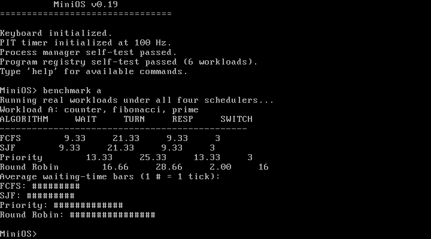

# MiniOS

MiniOS is a freestanding 32-bit x86 operating system built to make process
management and CPU scheduling observable. It boots independently through GRUB,
runs purpose-built workloads on separate process stacks, performs real context
switches, receives timer interrupts at 100 Hz, and supports four kernel-owned
scheduling algorithms.

The same ISO runs in QEMU and in the browser through v86. JavaScript never
calculates a schedule: the browser sends shell commands to the emulated PS/2
keyboard and visualizes state published by the kernel over its emulated COM1
serial port.



## Architecture

```text
Native path                              Browser path
QEMU virtual PC                         Web page
      |                                    |
      |                               v86 x86 emulator
      +---------------+--------------------+
                      |
                    GRUB
                      |
                 MiniOS kernel
                      |
       +--------------+---------------+
       |              |               |
 Process manager   Scheduler      PIT / PIC / IDT
       |              |               |
       +---------- Dispatcher --------+
                      |
             x86 context switch
                      |
         MiniOS workload processes

Kernel COM1 telemetry -> emulator UART -> browser process/timeline/stat views
Browser controls -> emulated PS/2 keyboard -> MiniOS shell -> kernel scheduler
```

The kernel uses no host operating-system libraries. VGA, PS/2, PIT, PIC, IDT,
UART, process stacks, and scheduling logic are implemented in the repository.

## Technologies

- C11 in freestanding 32-bit mode
- small x86 assembly entry, interrupt, and context-switch stubs
- GRUB Multiboot and `grub-mkrescue`
- GNU Make and linker script
- QEMU for native virtual-machine execution and automated integration tests
- React/TypeScript, CSS, vinext, and the official v86 package for the browser lab

## Project layout

```text
boot/       Multiboot header and 32-bit entry
kernel/     terminal, interrupts, processes, scheduling, metrics, telemetry
programs/   six deterministic MiniOS-native workloads
user/       keyboard-driven shell
tests/      QEMU end-to-end test harness
browser/    real v86 emulator and visualization dashboard
docs/       milestone notes, testing guide, and screenshots
```

## Build prerequisites

On Debian, Ubuntu, or WSL2:

```sh
sudo apt update
sudo apt install build-essential gcc-multilib grub-pc-bin grub-common xorriso qemu-system-x86
```

An `i686-elf` cross-compiler is also supported with
`make CROSS=i686-elf-`.

## Build and run with QEMU

```sh
make clean
make
make check
make run
```

The direct VM command is:

```sh
qemu-system-i386 -cdrom build/minios.iso
```

`make check` confirms that GRUB recognizes `build/minios.bin` as a 32-bit
Multiboot kernel.

## Shell commands

| Command | Purpose |
|---|---|
| `help` | List commands |
| `clear` | Clear and redraw the terminal |
| `about` | Show version and built-in workloads |
| `ps` | Display the PCB table |
| `run <program>` | Create and admit a workload process |
| `kill <pid>` | Terminate a queued process |
| `scheduler <fcfs\|sjf\|priority\|rr>` | Select an algorithm |
| `quantum <1-100>` | Set the Round Robin quantum in ticks |
| `start` | Dispatch all READY/WAITING work and restore the shell afterward |
| `stop` | Confirm that no workload owns the CPU while the shell is active |
| `stats` | Print per-process and system scheduling metrics |
| `timeline` | Print coalesced CPU ownership intervals |
| `ticks` | Read the live 100 Hz hardware tick count |
| `benchmark <a\|b>` | Run a fixed workload under all four schedulers |
| `selftest` | Run the kernel integration suite interactively |

Built-in programs are `counter`, `fibonacci`, `prime`, `short`, `long`, and
`io_test`. `io_test` periodically enters `WAITING`, wakes after two logical
ticks, and allows idle time or another READY process to run.

## Process management

MiniOS keeps up to 16 PCBs. Each PCB includes PID, name, state, priority,
arrival/burst/remaining time, program counter, a private 4 KiB stack, saved CPU
context, wake/block timing, and final statistics. State transitions use:

```text
NEW -> READY -> RUNNING -> TERMINATED
                    |
                    +-> WAITING -> READY
```

The assembly context switch saves flags and the x86 callee-saved registers,
stores the old stack pointer, loads the next process stack, and resumes it. New
stacks return through a kernel exit trampoline so the PCB is finalized safely.

## Scheduling algorithms

- **FCFS** is non-preemptive and uses arrival time, then PID. It is simple and
  low-overhead but can produce convoy delays.
- **SJF** is non-preemptive and chooses the smallest known burst, then PID. It
  often reduces average waiting but requires burst estimates and can starve
  long jobs.
- **Priority** is non-preemptive; lower numeric values mean higher priority.
  It supports urgent work but can starve low-priority processes.
- **Round Robin** is preemptive. The PIT interrupt rotates READY processes when
  their configurable quantum expires, improving responsiveness at the cost of
  more context switches.

## Metrics

All scheduler time is expressed in logical 100 Hz ticks:

```text
turnaround = completion - arrival
response   = first start - arrival
waiting    = turnaround - CPU burst - blocked time
CPU use    = busy ticks / elapsed ticks
throughput = completed processes / elapsed ticks
```

MiniOS also records first start, completion, context-switch count, and a
coalesced Gantt-style CPU timeline. Hundredths are calculated with integer
arithmetic, so the kernel does not need floating-point runtime support.

## Experimental results

Workload A uses `counter(8)`, `fibonacci(12)`, and `prime(16)`, all arriving at
tick zero. These results were recorded by the kernel with Round Robin quantum 2:

| Algorithm | Avg wait | Avg turnaround | Avg response | Switches |
|---|---:|---:|---:|---:|
| FCFS | 9.33 | 21.33 | 9.33 | 3 |
| SJF | 9.33 | 21.33 | 9.33 | 3 |
| Priority | 13.33 | 25.33 | 13.33 | 3 |
| Round Robin | 16.66 | 28.66 | 2.00 | 16 |

FCFS and SJF tie here because Workload A is already ordered by increasing
burst. Round Robin responds fastest but performs more switches. Priority follows
the workload priorities rather than shortest duration. The project deliberately
does not label one algorithm universally best.

## Automated tests

```sh
make test
```

The test harness boots the real ISO, enters `selftest` through the emulated
keyboard, and verifies the serial result. Thirteen passing cases cover PCB
lifecycle, zero/one/multiple processes, every scheduling algorithm, tie breaks,
Round Robin rotation and large quantum, context switching, timing calculations,
scheduler switching, and real WAITING/idle accounting. See
[docs/testing.md](docs/testing.md).

## Browser version

First build the ISO, then refresh the browser copy and start the dashboard:

```sh
make
make browser-image
cd browser
npm install
npm run dev
```

Open the local address printed by the development server. The interface includes
the live VGA terminal, keyboard interaction, process table, scheduler selector,
quantum control, execution timeline, and statistics. See
[browser/README.md](browser/README.md) for details.

## Milestone documentation

The implementation history is preserved in `docs/milestone-1.md` through
`docs/milestone-18.md`. Each stage describes the concept, build/run procedure,
expected behavior, important code, and validation checklist.

## Limitations

- single 32-bit x86 CPU; no user/kernel privilege separation
- fixed process table and statically allocated stacks
- no dynamic memory allocator, filesystem, networking, or USB
- polling keyboard input; timer-driven preemption only
- deterministic educational burst estimates rather than measured instruction counts
- the shell regains control after the active workload batch completes, so
  `stop` is informational rather than an asynchronous mid-process cancellation
- no aging for starvation prevention and no SMP support

## Future work

- make the shell an independently scheduled process for asynchronous pause/stop
- add priority aging and a preemptive SJF variant
- record explicit idle intervals in the Gantt timeline
- add protected user mode and simple memory isolation
- add saved emulator states for faster browser startup
